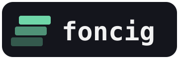

<p align="center">
  
</p>

<h3 align="center">Layered configuration for F#, identical on .NET, Fable JS and Fable Python.</h3>

<p align="center">
  Foncig follows the model of <code>Microsoft.Extensions.Configuration</code>: flat colon-separated keys
  (<code>Db:Host</code>, <code>Servers:0:Name</code>), case-insensitive, last source wins. Describe your settings with a
  <code>config { }</code> decoder, no attributes, no reflection. Built on <a href="https://github.com/dburriss/fnode">Fnode</a>.
</p>

<p align="center">
  <a href="https://www.nuget.org/packages/Foncig.Core"></a>
  <a href="https://www.nuget.org/packages/Foncig.Core"></a>
  <a href="https://github.com/dburriss/foncig/actions/workflows/build.yml"></a>
  <a href="https://github.com/dburriss/foncig/blob/main/LICENSE"></a>
</p>

## What it does

- **Layers.** Files, environment variables, the command line and in-memory records; later layers win. See [Concepts and API reference](docs/reference/concepts.md).
- **Provenance.** `Config.explain` shows where a value came from and everything it overrode. See [Trace where a value came from](docs/how-to/trace-a-value.md).
- **Typed, accumulating decoder.** `and!` collects every error at once instead of stopping at the first.
- **Predictable lists.** Replace by default; index merge and append are one call away. See [Control how lists merge](docs/how-to/control-list-merging.md).
- **Pure core.** Errors are values; nothing throws across the public API, and file and environment access lives in `Foncig.Host`.
- **Same everywhere.** Reflection-free, with deterministic number and time handling on .NET, Fable JS (Node, Bun, Deno) and Fable Python. See [Use Foncig with Fable](docs/how-to/use-with-fable.md).

## Get started

Add the [`Foncig.Defaults`](https://www.nuget.org/packages/Foncig.Defaults) package to an F# project. It brings the core, the file and environment shims, and the JSON and YAML formats; pick the smaller packages (`Foncig.Core`, `Foncig.Host`, `Foncig.Json`, `Foncig.Yaml`) if you want less:

```bash
dotnet add package Foncig.Defaults
```

Then describe your settings, build the layers and decode:

```fsharp
open Foncig

type Settings = { Host: string; Port: int; Tags: string list }

let settings: Decoder<Settings> =
    config {
        let! host = Decode.required "Db:Host"
        and! port = Decode.optional "Db:Port" 5432
        and! tags = Decode.list "Tags"
        return { Host = host; Port = port; Tags = tags }
    }

// appsettings.yaml, appsettings.{ENV}.yaml, ~/.myapp/config.yaml, MYAPP__* variables, command line
match ConfigBuilder.build (Defaults.configure "myapp") with
| Error errors -> errors |> List.iter (ConfigError.describe >> printfn "%s")
| Ok cfg ->
    match Decode.run settings cfg with        // Result<Settings, ConfigError list>, all errors at once
    | Ok s -> printfn "%A" s
    | Error errors -> errors |> List.iter (ConfigError.describe >> printfn "%s")
    Config.explain cfg "Db:Host" |> Option.iter (Explanation.describe >> printfn "%s")
```

`explain` shows the winning value and every layer that set it:

```
Db:Host = "cli"  <- args (--Db:Host=cli)
  1. "localhost"  appsettings.yaml:3:9
  2. "db.prod.internal"  appsettings.Production.yaml:3:9
  3. "cli"  args (--Db:Host=cli)
```

The [getting started tutorial](docs/tutorials/getting-started.md) walks through a complete program, and [examples/](examples/README.md) has the same program running on each target.

## Packages

| Package | What it is |
|---|---|
| [`Foncig.Core`](https://www.nuget.org/packages/Foncig.Core) | The pure core: keys, flattening, provenance, sources, merging, typed access, decoder, encoder |
| [`Foncig.Host`](https://www.nuget.org/packages/Foncig.Host) | Platform shims: env, argv, file read, home/cwd, paths; file sources by extension |
| [`Foncig.Json`](https://www.nuget.org/packages/Foncig.Json) | JSON file format |
| [`Foncig.Yaml`](https://www.nuget.org/packages/Foncig.Yaml) | YAML file format |
| [`Foncig.Defaults`](https://www.nuget.org/packages/Foncig.Defaults) | `Defaults.configure "app"`: the usual layers in one call |

You pay only for what you use. A TOML adapter later is one more package that supplies a `Fnode.Format`; the core does not change.

## Documentation

Organised by [Diataxis](https://diataxis.fr/), starting at the [docs index](docs/index.md):

| I want to... | Go to |
| --- | --- |
| Learn Foncig by doing | [Getting started](docs/tutorials/getting-started.md) |
| Get a specific job done | [Control how lists merge](docs/how-to/control-list-merging.md), [Trace where a value came from](docs/how-to/trace-a-value.md), [Use Foncig with Fable](docs/how-to/use-with-fable.md) |
| Look up a rule, source or type | [Concepts and API reference](docs/reference/concepts.md), [Fable target differences](docs/reference/fable-targets.md) |
| Understand why it works this way | [Design decisions](docs/explanation/design-decisions.md) |

More: [changelog](CHANGELOG.md) · [examples](examples/README.md)

## License

[MIT](LICENSE)
